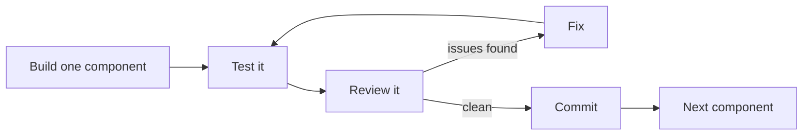

# Contributing

## Documentation style

All docs in this repo use **simple technical English**:

- Short sentences. One idea per sentence.
- Common words. Write "use", not "leverage". Write "check", not "validate the integrity of".
- Keep technical terms as they are (posting, fact, claim, checkpoint). Explain a term the first time you use it, or add it to the [glossary](docs/GLOSSARY.md).
- Use tables and lists for rules, options and steps. Use short paragraphs for reasons.
- Say *why*, not only *what*. Every rule should have a reason a new team member can understand.
- Draw it when a picture is clearer: Mermaid for flows, states and structure.
- Record important decisions as an ADR in [docs/adr](docs/adr/README.md).

## How work is done

Every component goes through the same loop. A component is one small piece that can be tested alone: a module of the domain, one graph, one adapter.

1. **Build** the component as its low-level design describes. If the design is wrong, fix the design first.
2. **Test** it: unit tests for rules, integration tests for adapters. The tests must fail before the fix and pass after it.
3. **Review** it against the checklist below. Break it on purpose (change a rule, remove a check) and see that a test fails. Write the findings in `docs/reviews/`.
4. **Fix** every finding, or record why it stays.
5. **Review again** until a pass finds nothing new.
6. At the end of each milestone, review the whole milestone. At the end of the project, review everything.

### Review checklist

| Area | Questions |
|---|---|
| Correctness | Does it do what the design says? What happens on the unhappy paths? |
| Truth | Can a sentence about the candidate reach a document without a fact behind it? Can the model change a score, a verdict or a state directly? |
| AI | What does the model decide here? Is its output parsed and checked? What happens if it is wrong, slow, or steered by a posting? |
| Outside world | Can this code send, post, apply or delete anything outside the machine? It must not. |
| Privacy | What leaves the machine in this step? Could a contact detail, the database or a key reach the model, a log or a test fixture? |
| Structure | Does the code respect the layers? Is each module in the right package? |
| Naming | Does every name say what the thing is, in the words of the glossary? |
| Tests | Is each rule tested where it lives? Are the edge cases covered? |
| Docs | Do the designs and the glossary still match the code? |

## Code structure

A package may only import the packages below it in this table ([ADR-0001](docs/adr/0001-layers.md)). A test enforces it.

| Layer | Package | Contains | May import |
|---|---|---|---|
| Hosts | `masar.cli`, `masar.mcp_server` | Commands, tools, wiring | Everything |
| Adapters | `masar.adapters` | SQLite, model providers, job boards, files | Everything below |
| Use cases | `masar.app` | One function or class per use case | `agent`, `ports`, `domain` |
| Agent | `masar.agent` | The graphs, the prompts, the model session | `ports`, `domain` |
| Ports | `masar.ports` | Protocols for what the world must provide | `domain` |
| Domain | `masar.domain` | Career file, job, screening, scoring, claim checks, application states | Nothing of ours; no I/O |

- Put a rule in `masar.domain` and test it there first.
- The domain has no I/O and no clock. Callers pass in what it needs.
- A host never holds a rule. It translates.
- In the domain, an expected failure is a result with findings, never an exception. A use case that will not do what was asked raises `Refused` (the answer is no) or `AppError` (it could not run), and a host turns that into an exit code or a tool error.
- Anything a model returns is parsed and checked before it is used ([ADR-0002](docs/adr/0002-model-writes-code-verifies.md)).

## Commits

- Use [Conventional Commits](https://www.conventionalcommits.org/): `feat:`, `fix:`, `docs:`, `test:`, `refactor:`, `build:`, `chore:`, `ci:`.
- Keep each commit small. Each one must pass the tests.
- The subject line is in the imperative, at most 72 characters. Use the body to explain why.
- A change to a prompt needs a new evaluation run, saved in `evals/results/`.
- Never commit a real career file, a database or a key. The examples use an invented person.
