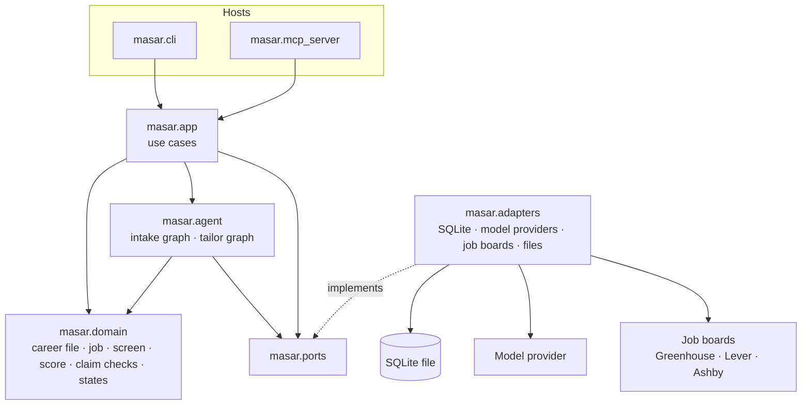
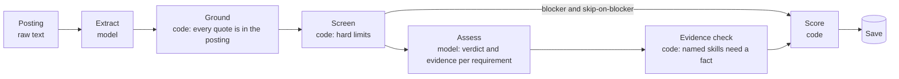
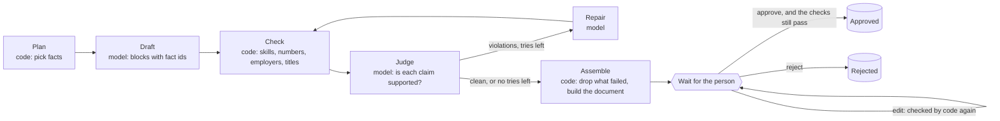
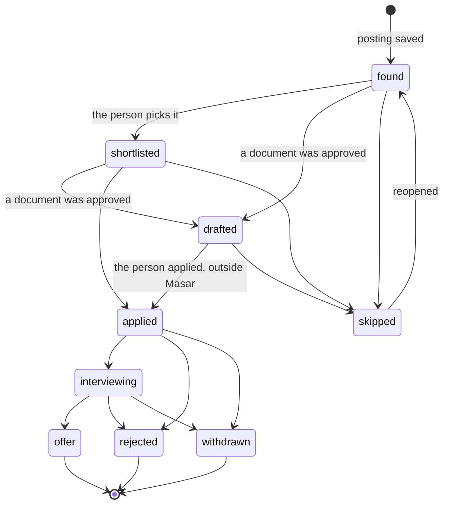

# Masar — High-level design

Important decisions are in the [ADRs](adr/README.md). Words are explained in the [glossary](GLOSSARY.md). Each part has a [low-level design](lld/README.md).

## 1. Context

Looking for a job is a pipeline of small, repeated tasks:

- Find postings, on many company career pages.
- Read each one, and decide if it is worth the time: the location, the visa, the seniority, the stack.
- Write a CV, a cover letter and a message that fit the posting.
- Remember what was sent to whom, and when to follow up.

A language model is good at reading a posting and at writing a letter. Left alone, it is also good at **inventing**: a skill the candidate does not have, a "senior" title, a number that sounds right. A letter with one invented claim is worse than no letter.

**Masar** (مسار, "path") is a personal job-hunt agent built around that risk:

1. It **collects** postings from pasted text and from the public job boards of a watchlist of companies.
2. It **reads** each posting into structured data, **screens** it against the candidate's hard limits, and **scores** it requirement by requirement, with evidence.
3. It **drafts** a tailored CV, cover letter and outreach message in English or Arabic. Every sentence about the candidate must rest on a fact from the candidate's own career file. Code checks this, and removes what it cannot verify.
4. It **tracks** applications and follow-ups.
5. It **never acts outside the machine**. It does not send, post or apply. A person approves every draft.

Masar is a tool for one person, running on that person's machine.

## 2. Goals and non-goals

### Goals

1. No sentence about the candidate reaches a document without a fact behind it. Skills, product names, numbers, employers and titles are checked by code.
2. A score that can be explained: each requirement of the posting has a verdict and the facts that support it. The code computes the score; the model never writes a number.
3. Hard limits are checked by code, before any writing: location, remote work, visa sponsorship, seniority, language, excluded companies.
4. A draft waits for a person. The flow pauses, survives a restart, and continues when the person decides.
5. Nothing personal leaves the machine except what a step needs: the posting, and the facts chosen for it. Contact details never go to a model.
6. A posting is untrusted text. Instructions hidden in it change nothing.
7. Work as a CLI and as an MCP server from the same code, with any model provider, and be testable with no model at all.
8. Measure the quality: extraction, assessment and claim checking each have an evaluation set.

### Non-goals (for now)

| Not included | Why |
|---|---|
| Applying or sending for the user | A wrong automatic application cannot be taken back. See [ADR-0003](adr/0003-no-outside-actions.md) |
| Scraping LinkedIn, Indeed, or any site that needs a login or forbids it | Terms of use, and it breaks every month. See [ADR-0004](adr/0004-sources.md) |
| Many users, a server, accounts | One person, one machine, one file |
| A web interface | The CLI and MCP clients are the interfaces |
| PDF or Word output | Documents are Markdown. Any converter can make a PDF |
| Interview practice, salary advice | Different problems. Maybe later |
| Deciding for the user | Masar recommends "apply", "maybe" or "skip" and shows why. The person decides |

## 3. Users

| User | What they need | How they use Masar |
|---|---|---|
| The candidate | Fewer hours per application, and no invented claims | The `masar` CLI, daily |
| The candidate, inside an AI assistant | To ask "what is new and worth applying to?" | The MCP server |
| A developer reading the code | To see how an agent is kept honest | The designs, the tests, the evaluations |

## 4. Facts that shape the design

| Fact | What it means for the design |
|---|---|
| A model can invent, and a CV is a document the candidate signs with their name | The model writes text; code decides what may stay ([ADR-0002](adr/0002-model-writes-code-verifies.md)) |
| The candidate's history is small and stable | It is written once, by hand, as a list of **facts** with ids: the career file ([ADR-0008](adr/0008-career-file.md)) |
| A posting is written by a stranger | It is data, never instructions ([ADR-0012](adr/0012-untrusted-postings.md)) |
| Some limits are not negotiable (a visa, a country) | They are fields and rules, not a matter of taste for a model |
| Many company boards publish postings through public JSON APIs | Three small clients cover many companies, with no scraping ([ADR-0004](adr/0004-sources.md)) |
| Approval may come hours later, in another process | The draft flow needs durable pause and resume ([ADR-0005](adr/0005-langgraph.md)) |
| Model calls cost money and time | Cheap code filters run before any model call; every run has a budget |

## 5. The parts

| Part | Owns | Depends on |
|---|---|---|
| **masar.domain** | The career file, the job model, screening, scoring, the claim checks, the application states. Pure code: no I/O, no clock | The standard library only |
| **masar.ports** | What the world must provide: a chat model, a store, job sources, a clock | Domain |
| **masar.agent** | The two flows as LangGraph graphs, the prompts, the model session with its budget and trace | Domain, ports, LangGraph |
| **masar.app** | Use cases: fetch, add, assess, tailor, decide a draft, move an application, today | Agent, ports, domain |
| **masar.adapters** | SQLite store, model providers (OpenAI-compatible, Anthropic), job-board clients, file loaders | Everything it implements |
| **masar.cli**, **masar.mcp_server** | Commands and tools. No rules | Everything |

The domain is a library first ([ADR-0001](adr/0001-layers.md)). The same `check_claims` call is used by the tailor flow, by a CLI command and by an MCP tool.

## 6. Main flows

### 6.1 From a posting to a scored job (the intake flow)

1. **Extract.** The model reads the posting into a fixed schema: title, seniority, workplace, locations, requirements. Each requirement carries a **quote** from the posting.
2. **Ground.** Code keeps a requirement only if its quote is really in the posting. A requirement the model made up is dropped and reported.
3. **Screen.** Code compares the job with the candidate's limits and returns flags: blockers and warnings. Missing information is a warning, never a blocker.
4. **Assess.** For each requirement the model gives a verdict (`met`, `partial`, `missing`) and the ids of the facts that show it.
5. **Evidence check.** Code checks every verdict: the fact ids exist; a `met` for a requirement that names a technology needs a fact with that technology. A verdict that fails is lowered.
6. **Score.** Code computes the score from the verdicts and their weights, and the recommendation from the score and the flags.

### 6.2 From a job to an approved document (the tailor flow)

1. **Plan.** Code picks the facts that matter for this job (the evidence of the assessment first) and the structure of the document.
2. **Draft.** The model writes the document as **blocks**. Each block names the facts it rests on.
3. **Check.** Code checks each block against its facts: every technology, name, number, employer and word of rank in the text must be in those facts.
4. **Judge.** A second model call reads each block that passed, with its facts, and says if the facts support it. It catches what word lists cannot: a claim that names nothing.
5. **Repair.** The model gets the list of violations and tries again, at most twice.
6. **Assemble.** Code drops any block that still fails, and builds the document. The header, contacts, education and skills list come from the career file, never from the model.
7. **Wait.** The flow pauses. The state is saved in the database, so the process can end. `masar drafts approve`, `reject` or `edit` continues it. Approval runs the code checks once more against the career file as it is then. An edit goes through the same code checks as a draft.

### 6.3 An application's life

Masar moves an application to `drafted` by itself when a document is approved. Every other move is the person's, with a note. `masar today` lists what needs attention: drafts that wait, shortlisted jobs with nothing drafted, applications with no news for a while.

## 7. Data

One SQLite file ([ADR-0006](adr/0006-sqlite.md)) and one YAML file.

| Where | What |
|---|---|
| `career.yaml` | The career file: the person, their limits, their facts. Written and owned by the person |
| `watchlist.yaml` | The companies to watch: a name, a source, a board id |
| `masar.db` | Postings, jobs, assessments, documents, applications and their events, runs and their steps, daily token use, and the graph checkpoints |

- Every assessment and document stores the checksum of the career file it was made from. When the file changes, old results say so.
- A posting's text is stored once, with a checksum, so the same posting from two fetches is one row.

## 8. Interfaces

| Interface | For | Summary |
|---|---|---|
| CLI | The candidate | `masar init`, `config`, `profile`, `facts`, `add`, `fetch`, `jobs`, `assess`, `tailor`, `drafts`, `export`, `apps`, `today`, `runs`, `check`, `eval` |
| MCP server | AI assistants | Read jobs and drafts, add a posting, run an assessment, draft a document, check claims. No approval, no state changes |
| Library | Python code | `masar.domain` with no host |

Details: [interfaces](lld/interfaces.md).

## 9. Security and privacy

- **No outside actions.** No code path sends a message, submits a form or writes outside the Masar folder and the export folder the person names ([ADR-0003](adr/0003-no-outside-actions.md)).
- **Approval is a human act.** Only the CLI can approve a draft or move an application. The MCP server has no such tool, so an assistant cannot approve for the person.
- **Postings are untrusted.** The model has no tools. Its output is parsed into a schema and checked. The model writes no score: code computes it from verdicts, and a verdict on a named technology needs a fact that has it. What hidden instructions in a posting can still do, and the bound on each, is in [ADR-0012](adr/0012-untrusted-postings.md).
- **Text from outside is cleaned at the door.** A posting is shown in a terminal and handed to assistants. Control characters and the marks that reorder text are removed when it is saved, and a block that holds one is refused.
- **Least data to the model.** A model call gets the posting and the facts chosen for the step. Name, email, phone and links are added by code after the model is done ([ADR-0009](adr/0009-privacy.md)). For the same reason an assistant gets a draft as its blocks, and never the finished text.
- **Keys** come from the environment, are never stored in the database, and print as `***`.
- **Budgets.** Each run has limits on model calls, tokens and time. Each day has a token limit.
- **Fetching** uses only the listed public APIs, with a timeout, a size limit and a named user agent.

## 10. Operations

| Topic | Design |
|---|---|
| Trace | Every step of every run is saved: the step, the model, the tokens, the time, the input checksum and the output. `masar runs show` prints it |
| Cost | Tokens per run and per day are stored and shown |
| Failure | A model answer that does not fit the schema gets one retry with the error, then the run fails with the reason. A failed source does not stop the others |
| Backup | One file to copy |
| Config | Environment variables. `masar config` shows them, with the key hidden |

## 11. Testing strategy

| Level | What it proves | Tools |
|---|---|---|
| Domain unit tests | Each screen rule, the score, each claim check, the state machine, the career file rules | pytest |
| Property tests | The score is in range and monotonic; a text made only of a fact's own words always passes the checks | Seeded random inputs |
| Graph tests | Both flows with a scripted model: repair, stop at the limits, pause and resume across a "restart" | A deterministic chat model |
| Injection tests | A model that obeys a posting's hidden instructions in full: the score stays below what was ordered, no technology the person lacks is `met`, no ordered claim is in the document | Fixtures |
| Adapter tests | The store on a real SQLite file; the job-board clients and model clients against answers in the shape of the real APIs | pytest, `httpx.MockTransport` |
| A whole day | From `init` to `applied` through the command line; the same day is the [demo](demo.md), which a test keeps up to date | Typer's runner |
| Host tests | CLI commands in process; MCP tools through an in-memory client | Typer's runner, the MCP SDK |
| Evaluations | Extraction, assessment and claim checking as numbers, with a real model on demand | Sets in `evals/`, results saved in the repo |
| Architecture test | The import rules between packages | The source files, read as a graph |

The build fails if the domain drops below 95% line coverage.

## 12. How we know it is honest

The promise in goal 1 is checked in three layers.

| Layer | What | When it runs |
|---|---|---|
| 1. Code checks | Technologies, names, numbers, employers and words of rank in a block must come from its facts | Always: on every draft, on every manual edit, and again at approval |
| 2. Model judge | A second model reads each block with its facts and says "supported" or not | On every draft, when a model is configured |
| 3. Evaluation | A set of drafts with planted false claims: the share that the checks catch, and the share of clean drafts they wrongly flag | In the tests (code checks), and on demand (with the judge) |

What the layers do **not** promise is in [section 13](#13-what-masar-is-not).

## 13. What Masar is not

- Masar does not guarantee that a document is true. It guarantees that technologies, names, numbers, employers and words of rank come from the career file, with the two limits the [claim checks](lld/grounding.md) name, and it asks a second model about the rest. The person reads every document before using it.
- The career file is the person's own statement. Masar does not check it against reality.
- A score is a reading aid, not a prediction of getting the job.
- Masar is not connected to any job board or employer. It reads what they publish.

## 14. Delivery plan

Details and "done when" lists are in the [build plan](plan/PLAN.md).

| # | Milestone | Result |
|---|---|---|
| M0 | Foundation | Package, tooling, CI, the architecture test |
| M1 | Career file and job model | The files and models everything else uses, with their rules |
| M2 | Screen and score | Hard limits and an explainable score, with no model |
| M3 | Claim checks | The code that keeps a document honest |
| M4 | Agent | The model port, the intake flow, the tailor flow with pause and resume |
| M5 | Storage and sources | SQLite, job boards, files |
| M6 | CLI and MCP server | The tool a person can use |
| M7 | Evaluations | Numbers for extraction, assessment and claim checking |
| M8 | Hardening | Injection and privacy pass, demo, final review |

## 15. Risks

| Risk | Answer |
|---|---|
| A false claim that uses no technology, number, employer or title word | The judge reads every block; the person approves every draft; section 13 says so plainly |
| The word lists flag a correct sentence (for example "Go" the language against "go" the verb) | Ambiguous names match only in their exact spelling; a flagged block is repaired or dropped, never silently kept; the evaluation measures wrong flags |
| A job board changes its JSON | Each client parses defensively and reports what it skipped; the fixtures in the tests show the expected shape |
| A model provider changes or is down | One small port, two adapters; every run fails with a clear reason and can be run again |
| The career file is thin | `masar profile check` reports facts without skills or dates; the assessment shows which requirements had no evidence |
| Costs grow with a long watchlist | Title filters and deduplication run before any model call; budgets per run and per day |
