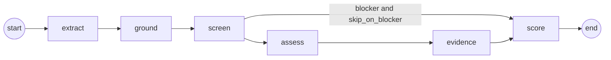
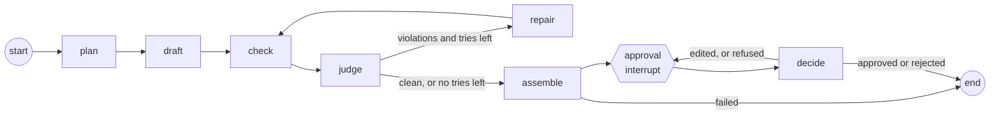

# Agent — the model session and the two graphs

`masar.agent` holds the flows as LangGraph graphs ([ADR-0005](../adr/0005-langgraph.md)), the prompts, and the session that wraps every model call. It imports the domain and the ports.

## The model session

One `ModelSession` per run. Every model call goes through it.

| Job | How |
|---|---|
| Budget | Limits on calls (12), total tokens (60,000) and wall time (180 s) per run, and 2,000 output tokens per call. Going over raises `BudgetExceeded`; the run fails with that reason |
| Daily budget | Before the first call, the use case checks the day's tokens against the daily limit (400,000) |
| JSON | `ask_json(step, messages, validate)` takes the first JSON object from the answer (also inside a code fence). An answer with no object, or with the wrong shape (no `requirements` list, blocks that are not blocks), gets one more call with the reason added; a second failure raises `ModelOutputError` |
| Provider failures | A network error or an HTTP error from the provider raises `ModelUnavailable` |
| Trace | Each call is recorded: step, model, prompt version, tokens in and out, milliseconds, a checksum of the input, and the output text. The input itself is not kept: it is the posting and the facts, which are stored already |

## Prompts

- The system message holds the rules and the output schema. The data comes in the user message, in labelled blocks: `<posting>`, `<job>`, `<facts>`, `<blocks>`, `<violations>`.
- Data cannot close its own block: text that looks like one of these labels is taken out of the data.
- Facts are sent as `id`, `kind`, `org`, `role`, `period`, `text`, `skills`. Never the person's name or contacts ([ADR-0009](../adr/0009-privacy.md)).
- The model is told that the posting is data and may contain instructions to ignore. The design does not depend on it obeying ([ADR-0012](../adr/0012-untrusted-postings.md)).
- Prompts are constants in one module, with a version string that is stored in the trace.

## The intake graph

| Node | Kind | Does |
|---|---|---|
| `extract` | model | Posting text → a candidate job (JSON) |
| `ground` | code | `ground_job`: keeps what the posting supports. No requirement left → the run ends as `unreadable` |
| `screen` | code | `screen`: flags |
| `assess` | model | Requirements and facts → verdicts with evidence |
| `evidence` | code | `check_evidence` |
| `score` | code | Score and recommendation |

State: the posting, then what each node adds: the job, the findings, the flags, the raw and checked assessment, the score, the status (`assessed`, `screened`, `unreadable`). The graph has no checkpointer: it runs in one call.

The career file, today's date and the model session are not in the state. They are given to the graph when it is built. So a state, and a checkpoint of it, holds only what the run produced.

The facts sent to `assess` are all facts of the career file when there are at most 60; above that, the ones that share a skill with the job, then the most recent, up to 60.

## The tailor graph

| Node | Kind | Does |
|---|---|---|
| `plan` | code | Picks the facts: the evidence of the assessment first, then facts that share a skill with the job, then experience, newest first, then the rest; at most 12 |
| `draft` | model | Writes the blocks for the document kind and language |
| `check` | code | `check_document`: violations per block |
| `judge` | model | For blocks that passed the code checks: supported or not. A claim is supported when its facts say it. A plain block is supported when it says nothing about the person: that is the one thing code cannot see. A verdict counts only for a block that was asked about, and only as true or false. The same words on the same facts are judged once |
| `repair` | model | Gets the failed blocks and their violations; returns a new text, and the facts it cites, for each. It cannot change a block's section or kind, and cannot touch a block that passed. An empty text removes the block. At most 2 times |
| `assemble` | code | Drops what still fails, builds the Markdown, or fails the draft |
| `approval` | interrupt | Pauses. Resumed with `approve`, `reject`, or `edit` with new blocks. It does nothing before the pause, because LangGraph runs the node again from its start on resume |
| `decide` | code | `reject`: ends. `approve`: runs the code checks once more, against the career file as it is now; a draft that no longer passes is not approved and stays waiting, with the reason. `edit`: the code checks on the new blocks and a new assembly; an edit that cannot be assembled is refused and the draft stays as it was. Anything else: refused |

- The graph is compiled with the SQLite checkpointer. The run id is the thread id. A paused run survives the end of the process: a new process builds the same graph on the same database and resumes by the run id.
- The graphs do not know the store. The use case in `masar.app` runs a graph, saves what it returns (the job, the pending draft), and on a decision resumes the graph and saves the result. The state holds plain data only, and never the career file.
- After `edit`, the draft is `pending` again, marked as edited and as not judged: no model is asked on a resume.
- The check at `approve` is inside the graph, so no host can skip it. The graph is built with the career file of the moment: what is approved is true today.
- A posting's text over 30,000 characters is cut before the model sees it, with a finding.
- The loop is bounded twice: the tries counter in the state, and a recursion limit of 25 on the graph.
- A block that the judge rejects is treated like any other violation (`NOT_SUPPORTED`): repaired, or dropped.
- When the judge or a repair stops (budget, or an answer that cannot be read twice), the model part of the flow is over: the code checks run on what there is, and the document says why it was not judged or not repaired.

## Failures

| Failure | Result |
|---|---|
| Model output that cannot be parsed, twice | The run fails: `model output` |
| Provider not reachable | The run fails: `model unavailable`; nothing is saved but the trace |
| Budget used up before the draft exists | The run fails: `budget` |
| Budget used up during the judge or a repair | The flow goes on to `assemble` with what it has; the document carries the warning |
| The judge or a repair cannot be read, twice | The same |
| The judge gives no verdict for some block | The document is marked as not judged |
| A posting with no requirement left after grounding | The job is saved as `unreadable`, with the findings |

## Tests

All with a scripted model that returns prepared answers in order and records what it was asked.

| Test | Proves |
|---|---|
| Intake, happy path | A posting becomes a job, flags, an assessment and a score |
| Intake, a made-up requirement | It is dropped before assessment and reported |
| Intake, a blocker | With skip on, no assess call is made |
| Intake, the model says `met` for a technology the person lacks | The verdict is lowered and the score follows |
| Tailor, happy path | Draft, clean check, judge, assemble, pause; approve after a "restart" with a new graph object on the same database |
| Tailor, repair | A violation is sent back with its reason; the second draft passes |
| Tailor, repair fails twice | The block is dropped and listed; the document is built without it |
| Tailor, judge rejects | The block is repaired or dropped |
| Budgets | Calls, tokens and time; the degraded path after the draft |
| Malformed output | One retry with the error; then a failed run |
| Privacy | No prompt contains the person's name, email, phone or links (checked on every recorded call) |
| Injection | A model that obeys a posting's orders in full: the score does not reach what was ordered, no technology the person lacks is `met`, and no ordered claim is in the document |
| Paused state | The checkpoint of a paused run holds no contact details outside the finished document |
| Approval after a change | A draft whose number was taken out of the career file is not approved |
